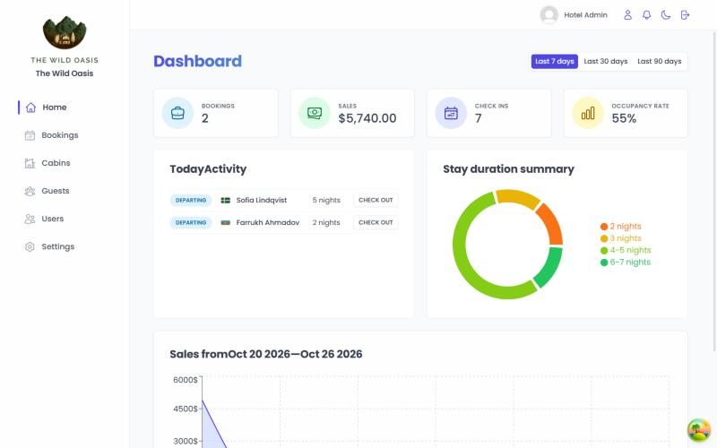
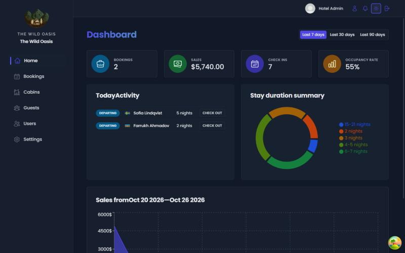
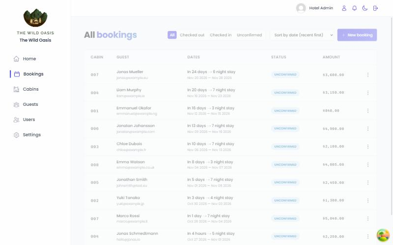
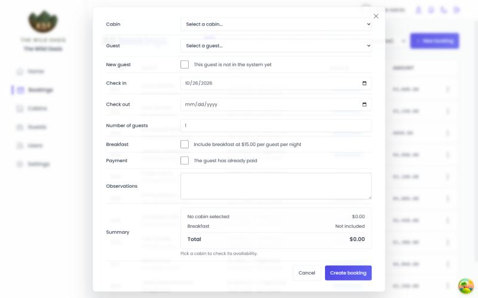
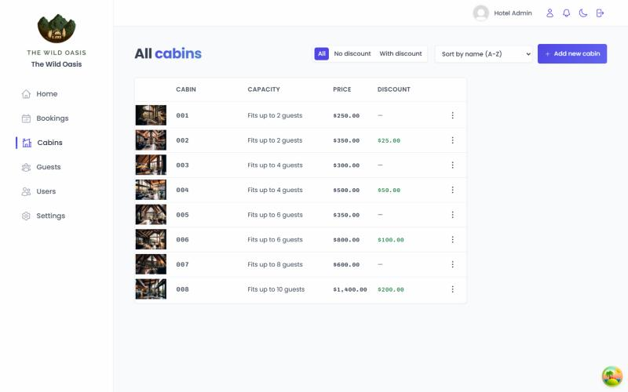
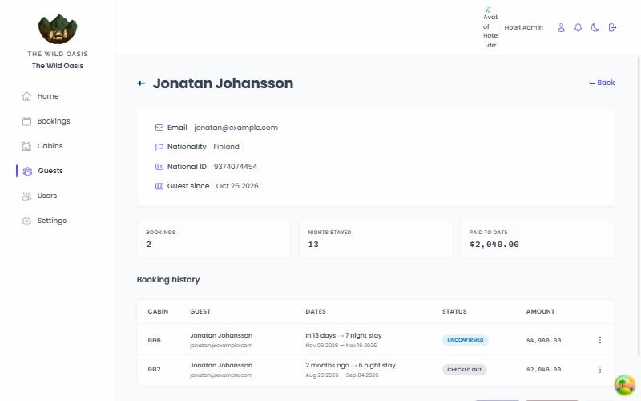
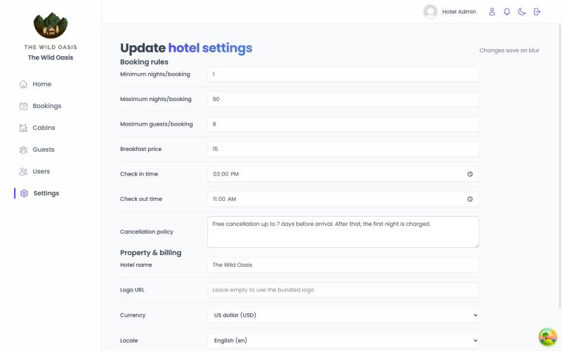

<div align="center">

# proDashboard

**A hotel management dashboard — cabins, guests, bookings, check-in and check-out, with a live activity feed.**

React 19 on the front, a NestJS API behind it, and `docker compose up` to see it all working.

[](https://react.dev)
[](https://nestjs.com)
[](https://prisma.io)
[](https://typescriptlang.org)
[](https://vite.dev)
[](https://docker.com)



</div>

---

## Try it in one command

```bash
docker compose up --build
```

Open **http://localhost:8080** and sign in:

| Email                       | Password       |
| --------------------------- | -------------- |
| `admin@prodashboard.local`  | `password1234` |

Both are prefilled on the login form. On first boot the API creates its database and seeds 8 cabins, 20 guests and 24 bookings spread across the past, today and the future — so every screen has real data, today's arrivals and departures included.

Your changes survive a restart. `docker compose down -v` wipes the volumes and gives you the clean demo back.

<details>
<summary><b>Running it for development instead</b></summary>

```bash
npm install
npm run setup   # installs the API's dependencies, creates and seeds the database
npm run dev     # Vite on :5173 and the API on :3000, together
```

`npm run dev:web` and `npm run dev:api` run one half at a time.

</details>

---

## What it does

### Dashboard

Bookings, sales, check-ins and occupancy across the last 7, 30 or 90 days, with a sales chart, a stay-duration breakdown, and the arrivals and departures waiting on the front desk today.



### Bookings

Filter by status, sort by date or amount, paginated with the next page prefetched.



Creating one is the most involved screen in the app. Pick a cabin and the form fetches its upcoming stays and **refuses to double-book it**, listing the conflicting dates. It prices the stay from the cabin's rate and discount, adds breakfast per guest per night, and validates nights and party size against the configured minimum, maximum and cabin capacity — all live, as you type.



A guest who isn't in the system yet can be created inline, without leaving the form.

### Check-in and check-out

Confirm payment, optionally add breakfast at the configured rate, and move a booking through `unconfirmed → checked-in → checked-out`.

### Cabins

Full CRUD with photo upload, discounts, and one-click duplicate.



### Guests

Searchable across name, email, nationality and ID — server-side, debounced, and kept in the URL so a search is linkable. Each guest gets a page with their stay history and totals.



### Settings

Booking rules, breakfast price, arrival and departure times, cancellation policy, tax rate, the hotel's name and logo — and currency and locale, which reformat **every price in the app**.



### Live activity feed

A bell in the header that fills in as bookings are created, guests check in or out, and payments land. It runs on server-sent events, so two open tabs stay in step without polling.

Plus dark mode throughout, and password reset.

---

## Architecture

```
proDashboard/
├── src/                      React 19 · Vite · styled-components · Tailwind
│   ├── features/             one folder per domain — bookings, cabins, guests, …
│   │   └── <domain>/         components + the hooks that fetch for them
│   ├── services/             the API client; nothing else touches the network
│   ├── ui/                   presentational and compound components
│   └── context/              dark mode, notifications
│
├── server/                   NestJS 11 · Prisma · SQLite
│   ├── prisma/               schema + seed
│   └── src/<resource>/       controller · service · DTOs, one per resource
│
├── docker-compose.yml
├── Dockerfile                web: Vite build → nginx
├── server/Dockerfile         api: build → run, seeds on first boot
└── nginx.conf                static serving + SPA fallback
```

**Frontend.** TanStack Query owns all server state — caching, invalidation and prefetching — so no global store is needed. React Hook Form handles the forms, Recharts draws the dashboard, and every list's filter, sort and page lives in the URL rather than component state.

**Backend.** One module per resource, DTO validation at the edge via `class-validator`, Prisma for data access, Passport JWT with bcrypt for auth, local disk for uploads, and an RxJS subject fanned out over SSE for the activity feed. Every endpoint is listed in **[server/README.md](server/README.md)**.

---

## A few decisions worth explaining

**The booking form re-checks availability at submit.** Overlap is `existingStart < newEnd && existingEnd > newStart`, so same-day turnover is allowed, and the check runs again on submit in case the cached availability went stale between opening the form and sending it.

**Currency is module state, not context.** `formatCurrency` is called from plain render code in a dozen components; threading a context through all of them would have been noise. The app shell waits for settings and applies the currency before the first render, so prices are never formatted wrong and then corrected.

**The activity feed reads diffs, not guesses.** Each SSE update carries the previous row alongside the new one, so "payment confirmed" is a real `false → true` transition rather than an inference from the current state.

**Deleting a guest with bookings is refused** at the service layer with a message the UI can show, instead of surfacing a raw foreign-key violation.

---

## Configuration

The client reads one variable, at **build** time:

| Variable       | Default                 | Notes                           |
| -------------- | ----------------------- | ------------------------------- |
| `VITE_API_URL` | `http://localhost:3000` | Where the browser finds the API |

Vite inlines it into the bundle, so pointing at a different API means rebuilding (`--build-arg VITE_API_URL=…`), not just restarting.

The API's variables are documented in **[server/.env.example](server/.env.example)**; `docker-compose.yml` sets them for you.

Switching from SQLite to Postgres is a change to `provider` and `DATABASE_URL` in `server/prisma/schema.prisma`.

---

## Before running this anywhere public

It's a portfolio project, and two things are deliberately simple:

- **`JWT_SECRET` in `docker-compose.yml` is a placeholder.** Replace it.
- **Password reset has no mailer.** `/auth/forgot-password` writes the reset link to the server log instead of sending it.

Creating an account requires being signed in already — the seed makes the first one. Remove the guard on `AuthController.signup` for open registration.

---

<div align="center">
<sub>Built with React, NestJS and Prisma.</sub>
</div>
